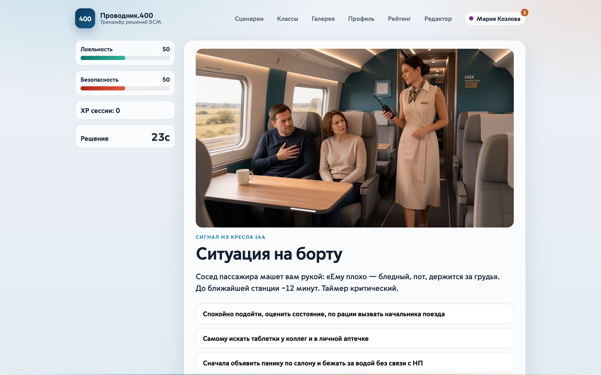
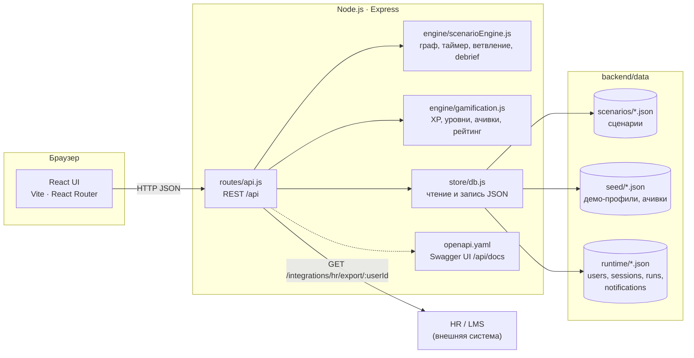
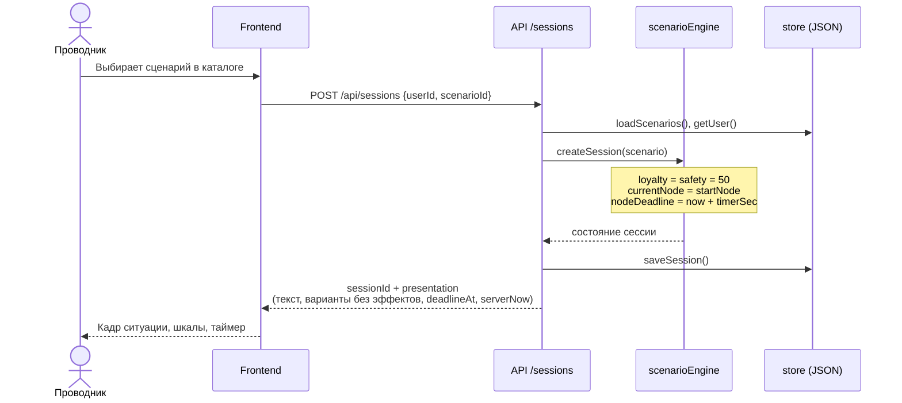
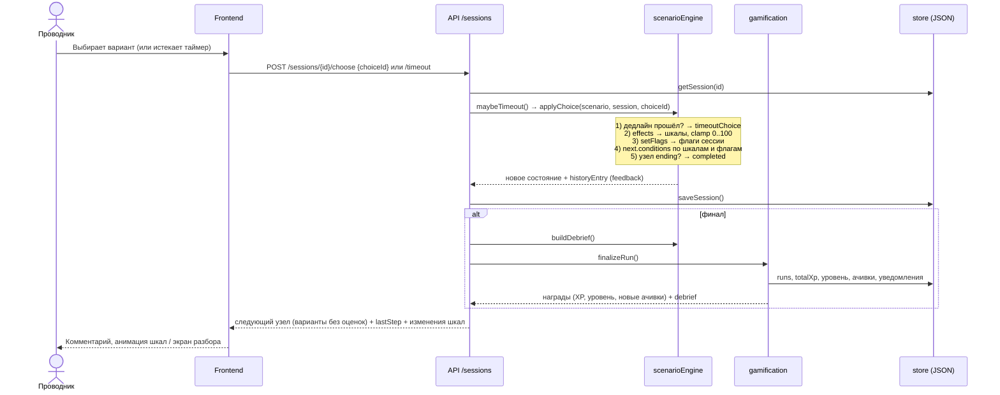
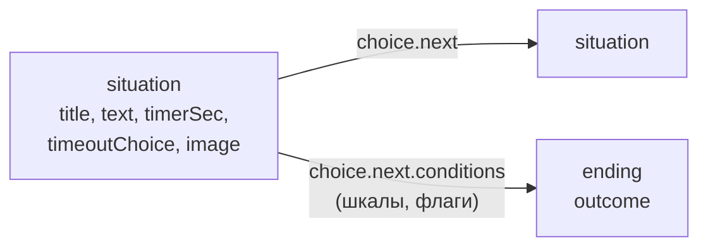
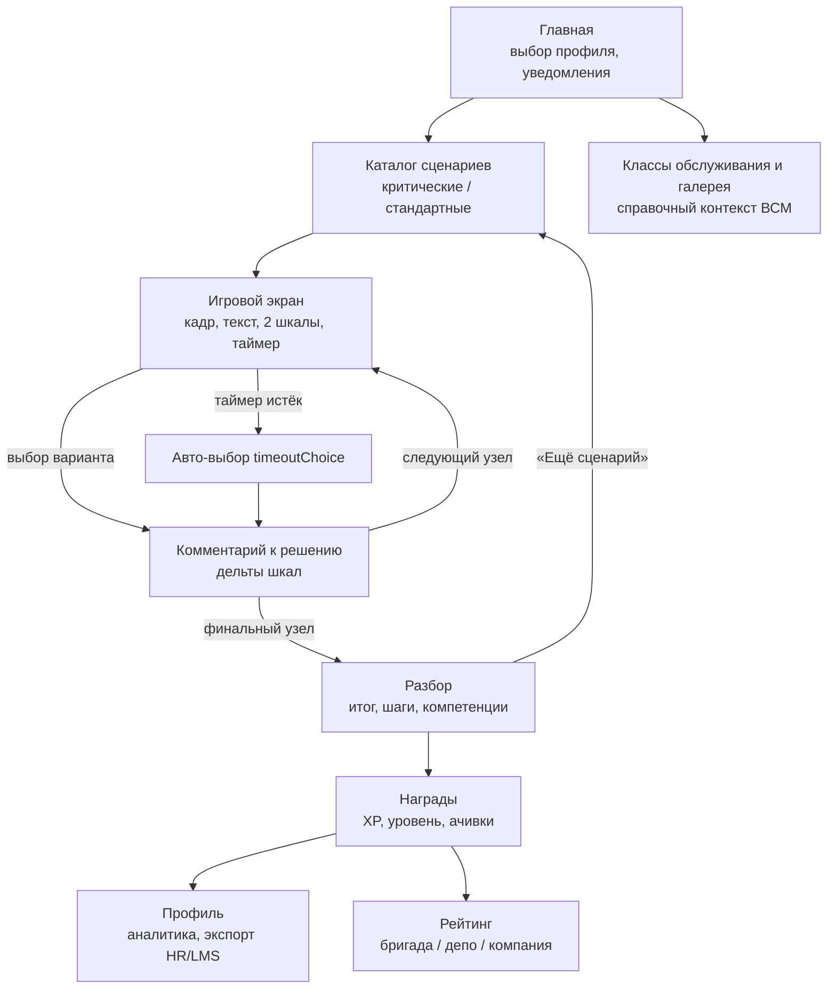
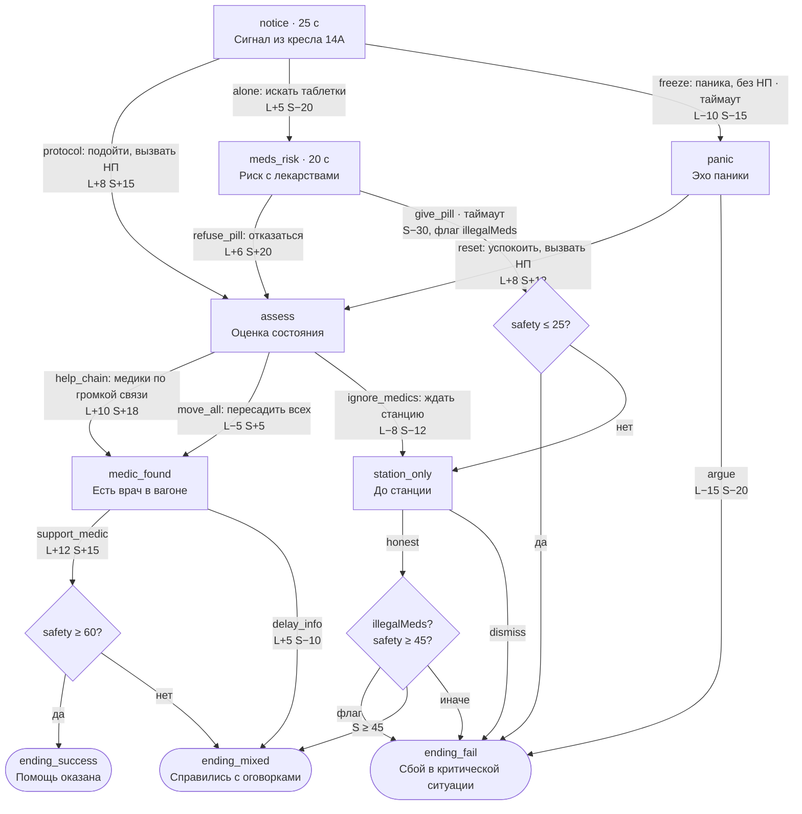
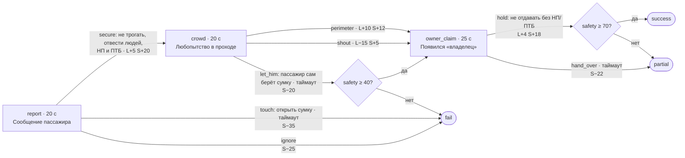

# Проводник.400

Тренажёр рабочих ситуаций для проводников ВСМ-400.

Проводник проходит бортовые сценарии с ограничением по времени. Каждое решение меняет две шкалы — лояльность пассажира и рейтинг безопасности, — а после финала разбирается по шагам. Есть профиль, XP, уровни, достижения и рейтинг по бригаде, депо и компании.



## Содержание

1. [Архитектура решения](#1-архитектура-решения)
2. [Локальный запуск и развёртывание](#2-локальный-запуск-и-развёртывание)
3. [Описание API](#3-описание-api)
4. [Пользовательский сценарий и примеры игровых сценариев](#4-пользовательский-сценарий-user-flow-и-примеры-игровых-сценариев)
5. [Структура репозитория](#структура-репозитория)
6. [Ограничения и развитие](#ограничения-и-развитие)

## Стек

| Слой | Технология |
|------|------------|
| Frontend | React 19, Vite 6, React Router 7 |
| Backend | Node.js 20+, Express 4 |
| Данные | JSON-файлы (демо-пользователи без реальных ПДн) |
| API | REST, OpenAPI 3, Swagger UI `/api/docs` |
| Сценарии | JSON в `backend/data/scenarios/` |
| Поставка | Docker, docker compose |

## Быстрый старт

```bash
npm install
npm run dev
```

- UI: http://localhost:5173
- API: http://localhost:8787/api/health
- Swagger: http://localhost:8787/api/docs

Профиль по умолчанию: Мария Козлова (`u-maria`).

---

## 1. Архитектура решения

Проводник.400 — одностраничное веб-приложение (React) и REST API (Node.js + Express). Сценарии, профили и сессии хранятся в JSON-файлах. Вся игровая логика (ветвления, таймер, эффекты, разбор) выполняется на сервере: клиент только показывает текущий узел и отправляет выбор.

### Диаграмма компонентов



| Компонент | Файл | Назначение |
|-----------|------|------------|
| UI | `frontend/src/` | Каталог, игровой экран, разбор, профиль, рейтинг, редактор |
| HTTP API | `backend/src/routes/api.js` | Роуты, валидация входа, коды ошибок |
| Движок сценариев | `backend/src/engine/scenarioEngine.js` | Граф узлов, таймер, условия переходов, флаги, debrief, валидация графа |
| Геймификация | `backend/src/engine/gamification.js` | XP, 10 уровней, 9 ачивок, компетенции, лидерборд |
| Хранилище | `backend/src/store/db.js` | Чтение сценариев и сидов, запись runtime-данных |
| Контракт API | `backend/src/openapi.yaml` | OpenAPI 3, отдаётся в Swagger UI и `/api/openapi.json` |
| Точка входа | `backend/src/index.js` | Express, заголовки безопасности, раздача собранного фронтенда |

В режиме разработки фронтенд работает на Vite (порт 5173) и проксирует `/api` на `:8787`. В прод-сборке Express сам раздаёт `frontend/dist`, и всё приложение доступно на одном порту.

### Последовательность: старт сессии



### Последовательность: решение игрока



Если клиент опоздал с ответом, `GET /sessions/{id}` после дедлайна сам применяет таймаут. Перезагрузка страницы время не продлевает.

### Ключевые решения

| Решение | Почему |
|---------|--------|
| Состояние сессии хранится в хранилище (`runtime/sessions.json`), а не в памяти процесса | Перезапуск сервера не обрывает прохождение. При переходе на БД API можно масштабировать горизонтально |
| Таймер проверяется на сервере (`nodeDeadline`) | Клиент не может «остановить время». Клиентский таймер нужен только для отображения, `serverNow` компенсирует расхождение часов |
| Эффекты, `feedback` и оценка варианта не отдаются во время игры | Правильный ответ нельзя подсмотреть в DevTools. Пояснения приходят только после выбора |
| Шкалы ограничены диапазоном 0..100 | Одна ошибка не уводит шкалу «в минус», итоги сопоставимы между сценариями |
| Переходы могут зависеть от шкал и флагов, а не только от выбора | Исход определяется траекторией: например, чужие лекарства (`illegalMeds`) ведут к провалу даже при честном финальном ответе |
| Сценарии — отдельные JSON-файлы, ядро не знает о конкретных кейсах | Методист добавляет кейс или развилку без правки кода и пересборки |
| Граф валидируется при старте и при каждой правке из редактора | Битая ссылка или узел без вариантов не попадают к проводнику |
| Вся работа с файлами — только в `store/db.js` | Замена JSON на PostgreSQL не затрагивает роуты и движок |
| Две независимые шкалы вместо одного балла | Сервис и безопасность конфликтуют. Один балл скрыл бы решения «приятно пассажиру, но опасно» |

### Модель сценария

Сценарий — это ориентированный граф. Узел имеет тип `situation` (с вариантами выбора) или `ending` (итог: `success`, `partial` или `fail`).



Вариант выбора (`choices[]`) содержит:

- `effects` — дельты `loyalty`, `safety`, `xp`;
- `feedback` и `betterAlternative` — пояснение для разбора;
- `competencyTags` — к каким компетенциям относится решение;
- `setFlags` — флаги сессии (например, `illegalMeds`);
- `next` — id узла или `{ conditions: [{ if: {...}, goto }, { else }] }`.

Условия поддерживают пороги шкал (`gte`, `lte`) и значения флагов.

При старте API каждый сценарий проходит `validateScenario()`: проверяются существование `startNode`, типы узлов, наличие вариантов и ссылки на существующие узлы. Та же проверка выполняется при добавлении развилки через редактор: невалидный граф не записывается.

### Хранение данных

| Каталог | Содержимое | В git |
|---------|------------|-------|
| `backend/data/scenarios/` | 9 сценариев | да |
| `backend/data/seed/` | 4 демо-профиля, 9 ачивок | да |
| `backend/data/runtime/` | прогресс, сессии, прогоны, уведомления | нет (`.gitignore`) |

Runtime-каталог создаётся автоматически из сидов при первом запуске. `store/db.js` — единственный модуль, который работает с файлами. Поэтому переход на PostgreSQL затрагивает только его, роуты и движок не меняются.

### Безопасность

- Клиент не получает `effects`, `feedback` и оценку варианта до выбора, так что по ответу API нельзя вычислить правильный вариант.
- Дедлайн узла хранится на сервере.
- Заголовки `X-Content-Type-Options: nosniff`, `X-Frame-Options: DENY`, `Referrer-Policy: no-referrer`.
- Тело запроса ограничено 1 МБ.
- В сидах только вымышленные сотрудники. Секретов в репозитории нет.

Подробнее: [docs/architecture.md](docs/architecture.md)

---

## 2. Локальный запуск и развёртывание

### Требования

- Node.js 20+ (проверено на 22) и npm
- Для контейнера — Docker 24+ с Compose v2

Внешних сервисов и баз данных не нужно: данные хранятся в JSON-файлах внутри репозитория.

### Локальный запуск (режим разработки)

```bash
git clone <repo-url> vsm-conductor
cd vsm-conductor
npm install
npm run dev
```

`npm install` ставит зависимости обоих workspace (`backend`, `frontend`). `npm run dev` поднимает два процесса через `concurrently`:

| Процесс | Адрес | Что это |
|---------|-------|---------|
| api | http://localhost:8787 | Express API, перезапуск при изменении файлов (`node --watch`) |
| web | http://localhost:5173 | Vite dev-сервер, проксирует `/api` на `:8787` |

Откройте http://localhost:5173. Профиль по умолчанию — Мария Козлова (`u-maria`). Переключить профиль можно на главной странице.

Если порт 5173 занят, Vite выберет следующий свободный (5174, 5175, …) и напишет его в консоли.

### Проверка работоспособности

```bash
curl http://localhost:8787/api/health
```

Ожидаемый ответ: `{"ok":true,"service":"vsm-conductor-api",...}`.

```bash
npm run selfcheck
```

Проверка движка без HTTP: валидирует графы всех сценариев, прогоняет выбор, таймаут и сборку разбора.

```bash
npm run smoke
```

Сквозной тест по живому API: health → каталог → сессия → выборы → завершение → debrief. Нужен запущенный backend. Адрес API можно переопределить: `API_URL=http://host:8787/api npm run smoke`.

### Прод-сборка без Docker

```bash
npm install
npm run build
npm start
```

`npm run build` собирает фронтенд в `frontend/dist`. `npm start` запускает Express, который отдаёт API и собранный фронтенд с одного порта: http://localhost:8787.

### Docker

```bash
docker compose up --build
```

Приложение: http://localhost:8787, Swagger: http://localhost:8787/api/docs.

Что делает `Dockerfile`:

1. Стадия `build` на `node:22-alpine`: ставит зависимости и собирает фронтенд.
2. Финальная стадия: только backend с прод-зависимостями и `frontend/dist`, `NODE_ENV=production`.

Прогресс, сессии и уведомления пишутся в том `conductor-runtime` (`/app/backend/data/runtime`), поэтому они переживают пересоздание контейнера. Сценарии лежат внутри образа: после правки JSON-файлов пересоберите образ.

Сброс демо-данных:

```bash
docker compose down -v
```

### Переменные окружения

| Переменная | По умолчанию | Назначение |
|------------|--------------|------------|
| `PORT` | `8787` | Порт Express API |
| `NODE_ENV` | — | `production` в контейнере |
| `API_URL` | `http://localhost:8787/api` | Адрес API для `npm run smoke` |

Секретов приложение не использует, `.env` не нужен.

### Данные

| Путь | Что | Как сбросить |
|------|-----|--------------|
| `backend/data/scenarios/` | Сценарии | — (часть кода) |
| `backend/data/seed/` | Демо-профили и ачивки | — (часть кода) |
| `backend/data/runtime/` | Прогресс, сессии, прогоны | Удалить каталог: при старте он пересоздаётся из `seed/` |

Сбросить один профиль можно кнопкой «Сбросить прогресс» в профиле или запросом `POST /api/users/{id}/reset`.

### Добавление сценария

1. Скопируйте любой файл из `backend/data/scenarios/` и задайте новый `id`.
2. Опишите узлы (`nodes`) и `startNode`. Формат — в [user-flow.md](docs/user-flow.md#добавление-развилки).
3. Положите обложку и кадры в `frontend/public/scenes/`.
4. Перезапустите API и выполните `npm run selfcheck`. Ошибки графа также выводятся в лог при старте.

### Частые проблемы

| Симптом | Причина и решение |
|---------|-------------------|
| `EADDRINUSE :8787` | Порт занят другим процессом. Освободите его или запустите с `PORT=8788` (и поправьте прокси в `frontend/vite.config.js`) |
| UI открывается, но данных нет | API не запущен или прокси смотрит не туда. Проверьте `curl localhost:8787/api/health` |
| Белый экран на 5173 | На этом порту работает чужое приложение. Смотрите в консоли `npm run dev`, какой порт выбрал Vite |
| В логе `[scenario:…] validation` | В JSON сценария ссылка на несуществующий узел или узел без вариантов |

Подробнее: [docs/deployment.md](docs/deployment.md)

---

## 3. Описание API

Базовый URL: `http://localhost:8787/api`

Контракт OpenAPI 3: [`backend/src/openapi.yaml`](backend/src/openapi.yaml).

- Интерактивно: [Swagger UI](http://localhost:8787/api/docs), там же можно отправлять запросы.
- В JSON: `GET /api/openapi.json`.

Все запросы и ответы — JSON. Авторизации в демо нет: пользователь передаётся через `userId`.

### Методы

#### Служебные

| Метод | Путь | Описание |
|-------|------|----------|
| GET | `/health` | Проверка живости: `{ ok, service, ts }` |

#### Сценарии

| Метод | Путь | Описание |
|-------|------|----------|
| GET | `/scenarios` | Каталог: id, название, сложность, длительность, компетенции, обложка |
| GET | `/scenarios/{id}` | Метаданные сценария + результат валидации графа |
| POST | `/scenarios/{id}/choices` | Добавить развилку в узел (используется экраном «Редактор») |

#### Сессии — игровой цикл

| Метод | Путь | Тело | Описание |
|-------|------|------|----------|
| POST | `/sessions` | `{ userId, scenarioId }` | Старт → `{ sessionId, presentation }` |
| GET | `/sessions/{id}` | — | Текущий узел. Если дедлайн прошёл, сначала применяется таймаут (`timedOutApplied: true`) |
| POST | `/sessions/{id}/choose` | `{ choiceId }` | Применить выбор → следующий узел или финал с разбором |
| POST | `/sessions/{id}/timeout` | — | Время вышло: применяется `timeoutChoice` узла |
| GET | `/sessions/{id}/debrief` | — | Разбор завершённой сессии |

#### Профиль и геймификация

| Метод | Путь | Описание |
|-------|------|----------|
| GET | `/users` | Список демо-профилей |
| GET | `/users/{id}` | Профиль, уровень, ачивки |
| POST | `/users/{id}/reset` | Сброс прогресса из seed |
| GET | `/users/{id}/analytics` | Средние итоги, сильные компетенции и пробелы |
| GET | `/leaderboard?scope=company\|depot\|brigade&depotId=&brigadeId=` | Рейтинг |
| GET | `/achievements` | Справочник ачивок |
| GET | `/notifications/{userId}` | Уведомления |
| POST | `/notifications/{userId}/read` | Отметить прочитанными |

#### Интеграции

| Метод | Путь | Описание |
|-------|------|----------|
| GET | `/integrations/hr/export/{userId}` | Пакет прогресса для HR/LMS (формат `vsm-conductor.hr.v1`) |

### Форматы

#### presentation — узел для клиента

```json
{
  "nodeId": "report",
  "type": "situation",
  "title": "Сообщение пассажира",
  "text": "«Там у двери чья-то чёрная сумка…»",
  "image": "/scenes/scene-bag.jpg",
  "competencyFocus": ["безопасность"],
  "loyalty": 50,
  "safety": 50,
  "xp": 0,
  "status": "active",
  "timerSec": 20,
  "deadlineAt": 1790521060157,
  "serverNow": 1790521040158,
  "choices": [
    { "id": "secure", "text": "Не трогать вещь, попросить людей отойти…" }
  ]
}
```

До выбора клиент получает только `id` и `text` варианта. Эффекты, пояснения и оценка варианта не отдаются, это проверяется в `npm run selfcheck`. `serverNow` нужен, чтобы клиент считал оставшееся время по серверным часам.

Для финального узла `type` = `ending`, добавляются `outcome` (`success` / `partial` / `fail`) и `summary`, а `choices` пустой.

#### Ответ на выбор

```json
{
  "presentation": { "...": "следующий узел" },
  "lastStep": {
    "index": 1,
    "nodeId": "report",
    "choiceText": "Не трогать вещь, попросить людей отойти, сразу сообщить НП и ПТБ",
    "timedOut": false,
    "effects": { "loyalty": 5, "safety": 20, "xp": 25 },
    "feedback": "Дистанция + оповещение ответственных служб.",
    "betterAlternative": null,
    "competencyTags": ["безопасность", "регламент"]
  },
  "completed": false
}
```

На финальном шаге `completed: true` и добавляются:

- `debrief`: `scenarioId`, `title`, `outcome`, `endingText`, `finalLoyalty`, `finalSafety`, `xpEarned`, `steps[]`, `competencies`, `tips[]`;
- `rewards`: `xpGain`, `level { level, totalXp, xpToNext, … }`, `newlyUnlocked[]` — новые ачивки;
- `user`: обновлённый профиль.

#### Добавление развилки

`POST /scenarios/{id}/choices`

```json
{
  "nodeId": "boarding",
  "choice": {
    "id": "lab_option",
    "text": "Предложить пассажиру пройти в тамбур и спокойно объяснить правило ещё раз",
    "next": "resist",
    "effects": { "loyalty": 5, "safety": 5, "xp": 10 },
    "feedback": "Дополнительный сервисный вариант."
  }
}
```

Перед записью в файл граф проверяется заново. Если проверка не прошла, файл не меняется и возвращается `400` с `details`.

#### Экспорт для HR/LMS

```json
{
  "format": "vsm-conductor.hr.v1",
  "exportedAt": "2026-09-27T14:57:20.254Z",
  "employeeSyntheticId": "u-anna",
  "displayName": "Анна Смирнова",
  "depotId": "depot-msk",
  "brigadeId": "brigade-7",
  "competencies": {
    "strong": [{ "name": "безопасность", "xp": 139 }],
    "weak": [{ "name": "сервис", "xp": 20 }],
    "all": { "безопасность": 139, "регламент": 127, "сервис": 20 }
  },
  "level": { "level": 2, "totalXp": 190 }
}
```

### Ошибки

Тело ошибки: `{ "error": "текст", "details"?: [...] }`.

| Код | Когда |
|-----|-------|
| 400 | Нет `choiceId`; сессия уже завершена; невалидная развилка; нужен существующий `userId` |
| 404 | Сценарий, сессия или пользователь не найдены |
| 409 | Вариант с таким `id` уже есть в узле |
| 500 | Сценарий повреждён (граф не прошёл валидацию) или внутренняя ошибка |

Неизвестный `choiceId` не считается ошибкой: он засчитывается как таймаут (`timedOut: true`), так же как пропуск ответа.

### Пример: полный проход через curl

```bash
API=http://localhost:8787/api

# 1. старт
SID=$(curl -s -X POST $API/sessions \
  -H 'content-type: application/json' \
  -d '{"userId":"u-maria","scenarioId":"unattended-bag"}' | node -pe 'JSON.parse(require("fs").readFileSync(0)).sessionId')

# 2. три решения
for c in secure perimeter hold; do
  curl -s -X POST $API/sessions/$SID/choose \
    -H 'content-type: application/json' -d "{\"choiceId\":\"$c\"}" > /dev/null
done

# 3. разбор
curl -s $API/sessions/$SID/debrief
```

Тот же сценарий автоматически проходит `npm run smoke`.

Подробнее: [docs/api.md](docs/api.md) · контракт: [backend/src/openapi.yaml](backend/src/openapi.yaml)

---

## 4. Пользовательский сценарий (User Flow) и примеры игровых сценариев

### Роли

| Роль | Что делает |
|------|------------|
| Проводник | Проходит сценарии, смотрит разбор, растёт в уровне и рейтинге |
| Методист / наставник | Добавляет развилки в «Редакторе» или новые сценарии в JSON, смотрит рейтинг бригады |
| HR / LMS | Забирает прогресс сотрудника через `GET /integrations/hr/export/{userId}` |

### Путь проводника по экранам



1. **Главная.** Проводник выбирает демо-профиль (по умолчанию Мария Козлова). Видит уровень, XP, ачивки и уведомления, например челлендж бригады.
2. **Каталог.** 9 сценариев с обложкой, сложностью, длительностью и компетенциями.
3. **Игровой экран.** Слева шкалы «Лояльность» и «Безопасность» (старт 50/50), XP сессии и таймер. Справа кадр ситуации, текст и 2–3 варианта. Какой вариант верный, не видно.
4. **После выбора.** Короткий комментарий тренажёра, шкалы меняются с показом дельты, затем следующий узел.
5. **Таймер истёк.** Засчитывается `timeoutChoice` узла — как правило, это пассивный или неверный вариант. Промедление тоже решение.
6. **Разбор.** Итоговые шкалы, вывод по исходу, каждый шаг с пояснением и лучшей альтернативой, сильные компетенции и пробелы.
7. **Награды.** XP, новый уровень, открытые ачивки. Данные сразу попадают в профиль и рейтинг.

### Каталог сценариев

| ID | Название | Тип | Таймер, с | Узлов | Вариантов | Компетенции |
|----|----------|-----|-----------|-------|-----------|-------------|
| `medical-emergency` | Пассажиру стало плохо | критический | 20–30 | 9 | 14 | безопасность, эмпатия, регламент |
| `unattended-bag` | Бесхозная вещь | критический | 20–25 | 6 | 8 | безопасность, регламент, конфликты |
| `smoking-onboard` | Курение на борту | критический | 18–20 | 5 | 5 | безопасность, регламент, конфликты |
| `lost-child` | Ребёнок потерялся | критический | 22–25 | 6 | 7 | эмпатия, безопасность, регламент |
| `pet-carrier` | Питомец без переноски | стандарт | 20–30 | 9 | 14 | сервис, регламент, эмпатия |
| `boarding-ticket` | Посадка без действительного билета | стандарт | 15–30 | 8 | 12 | регламент, эмпатия, сервис |
| `cabin-conflict` | Шум и спор в салоне | стандарт | 15–25 | 7 | 10 | конфликты, эмпатия, сервис |
| `pet-allergy` | Аллергия на животных | стандарт | 18–28 | 7 | 10 | эмпатия, сервис, безопасность |
| `luggage-aisle` | Ручная кладь в проходе | стандарт | 20–22 | 6 | 7 | безопасность, сервис, эмпатия |

Всего 63 узла, 87 вариантов решений, 27 финалов: у каждого сценария есть `success`, `partial` и `fail`.

### Пример 1. «Пассажиру стало плохо» (`medical-emergency`)

Бизнес-класс, маршрут Москва — Санкт-Петербург. До ближайшей станции ~12 минут.

#### Граф ветвлений



#### Три прохождения

Старт: лояльность 50, безопасность 50. Шкалы ограничены диапазоном 0..100.

| Шаг | Эталон | С оговорками | Провал |
|-----|--------|--------------|--------|
| 1 | `protocol` → 58 / 65 | `protocol` → 58 / 65 | `alone` → 55 / 30 |
| 2 | `help_chain` → 68 / 83 | `move_all` → 53 / 70 | `give_pill` (или таймаут) → 59 / 0, флаг `illegalMeds` |
| 3 | `support_medic` → **80 / 98** | `delay_info` → **58 / 60** | — |
| Исход | `success`, +70 XP | `partial`, +30 XP | `fail`, 0 XP |

Что показывает разбор:

- **Эталон.** «Вы — координатор помощи, а не „главный врач“». На первом прохождении, например, открываются ачивки «Первая смена», «Страж безопасности», «Баланс профессионала».
- **С оговорками.** Про пересадку всего салона: «Хаос в проходе мешает помощи. Достаточно освободить доступ к креслу». Про обещания пассажирам: «Нельзя давать непроверенные обещания о движении поезда». К каждому пояснению приложена лучшая альтернатива.
- **Провал.** «Личные лекарства выдавать нельзя: неизвестна реакция, ответственность ляжет на вас». Лучшая альтернатива — вызвать начальника поезда и действовать в рамках аптечки.

Ключевая механика: в узле `meds_risk` по таймауту засчитывается `give_pill`. Растерянность в критической ситуации приводит к худшему исходу, а флаг `illegalMeds` не даёт «отыграться» на следующем шаге.

### Пример 2. «Бесхозная вещь» (`unattended-bag`)



Эталон `secure → perimeter → hold` даёт `success`: 69 / 100, +70 XP. Этот путь проверяет `npm run smoke`. Если на первом шаге промедлить, засчитывается `touch` («открыть сумку») — это сразу провал: бесхозную вещь трогать нельзя.

### Пример 3. «Питомец без переноски» (`pet-carrier`)

Стандартный кейс на конфликт сервиса и правил.

- `calm_rule → offer_buy → help_place` — эталон: правило соблюдено, пассажир доволен.
- `wave_through` («раз маленькая — проходите») даёт лояльность +8, но безопасность −18. Дальше жалоба соседа на аллергию, и лучший возможный исход — `partial`.
- `bark` (жёсткий отказ) ведёт к эскалации. Выйти можно только через деэскалацию и подключение начальника поезда.

### Пример 4. «Шум и спор в салоне» (`cabin-conflict`)

Тихая личная просьба (`soft`), нейтралитет при ответной реакции (`separate` или `call_np`) и повторный подход к пассажиру (`followup`) дают `success`. Если встать на сторону одного из пассажиров (`take_side`) или снимать конфликт на телефон (`film`), ситуация ухудшается или проваливается.

### Методист: добавление развилки

Через интерфейс: **Редактор** (`/lab`) → выбрать сценарий и узел → текст варианта, следующий узел, дельты шкал, XP, пояснение → «Добавить развилку в JSON». Граф проверяется перед записью, и новый вариант доступен со следующего прохождения.

Вручную — в JSON сценария, массив `choices[]` у узла:

```json
{
  "id": "new_branch",
  "text": "Новый вариант",
  "effects": { "loyalty": 5, "safety": -5, "xp": 10 },
  "competencyTags": ["сервис"],
  "feedback": "Пояснение после выбора",
  "betterAlternative": "Что было бы лучше (для слабых вариантов)",
  "next": "existing_node_id"
}
```

Условный переход:

```json
"next": {
  "conditions": [
    { "if": { "safety": { "gte": 60 } }, "goto": "ending_success" },
    { "if": { "flags": { "illegalMeds": true } }, "goto": "ending_fail" },
    { "else": "ending_mixed" }
  ]
}
```

Новый сценарий — это новый файл в `backend/data/scenarios/`, подробнее в [deployment.md](docs/deployment.md#добавление-сценария). Медиа кладутся в `frontend/public/scenes/`: поле `coverImage` у сценария и `image` у узла.

Подробнее: [docs/user-flow.md](docs/user-flow.md)

---

## Структура репозитория

```
backend/
  src/
    index.js               точка входа Express, заголовки безопасности, раздача фронтенда
    routes/api.js          HTTP API
    engine/
      scenarioEngine.js    граф, таймер, ветвление, debrief, валидация
      gamification.js      XP, уровни, ачивки, рейтинг
      selfcheck.js         самопроверка движка (npm run selfcheck)
    store/db.js            чтение и запись JSON
    openapi.yaml           контракт API
  data/
    scenarios/             9 сценариев
    seed/                  демо-профили и ачивки
    runtime/               прогресс и сессии (создаётся при запуске, не в git)
frontend/
  src/pages/               Home, Play, Debrief, Profile, Leaderboard, Lab, Classes, Gallery
  public/scenes/           обложки и кадры сценариев
scripts/smoke.mjs          сквозной тест по живому API (npm run smoke)
docs/                      документация, схемы, презентация
Dockerfile, docker-compose.yml
```

## Ограничения и развитие

### Сейчас

1. Хранение в JSON-файлах — удобно для локального запуска, не для высокой нагрузки.
2. Нет корпоративного SSO: пользователь выбирается из списка демо-профилей.
3. Набор сценариев расширяется добавлением JSON, UI-редактор покрывает только новые развилки.
4. Нужен доступ к API (офлайн-режима нет).

### Данные

В демо используются вымышленные ФИО и идентификаторы. Реальных пассажирских и кадровых ПДн нет.

### Дальше

- Postgres и JWT / корпоративный IdP
- Полноценный редактор сценариев для методистов
- Выгрузка прогресса в LMS
- Мобильный клиент и push по сменам

## Документация

- [Архитектура](docs/architecture.md)
- [Запуск и развёртывание](docs/deployment.md)
- [API](docs/api.md) и [OpenAPI](backend/src/openapi.yaml)
- [Пользовательский сценарий и примеры](docs/user-flow.md)
- [Схемы картинками](docs/diagrams/)
- [Презентация (PDF)](docs/pitch/Проводник-400.pdf)
