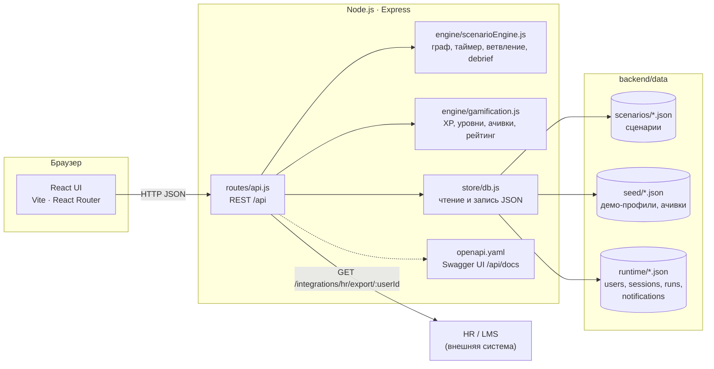
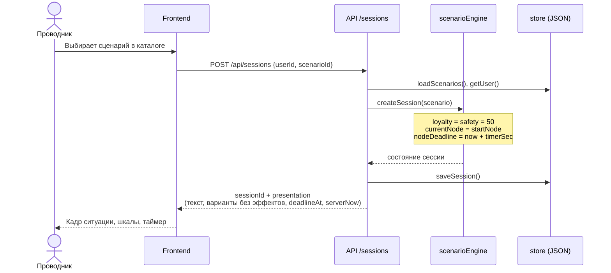
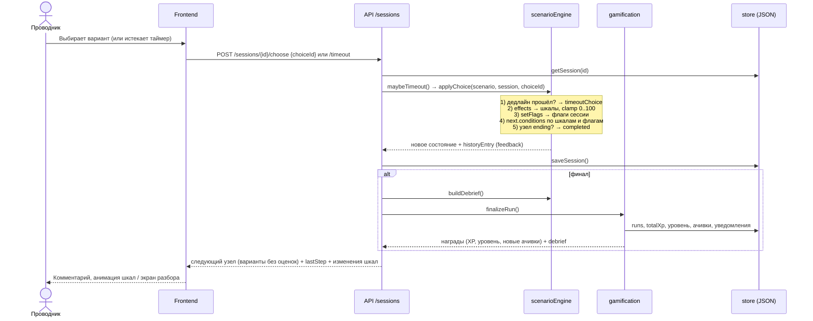
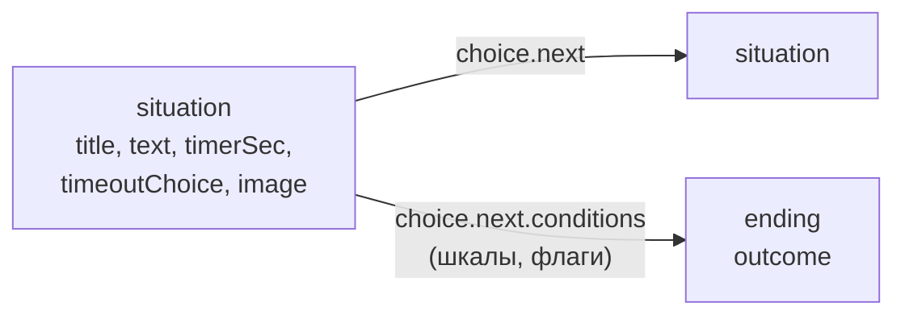

# Архитектура

Проводник.400 — одностраничное веб-приложение (React) и REST API (Node.js + Express). Сценарии, профили и сессии хранятся в JSON-файлах. Вся игровая логика (ветвления, таймер, эффекты, разбор) выполняется на сервере: клиент только показывает текущий узел и отправляет выбор.

## Диаграмма компонентов

| Компонент | Файл | Назначение |
|-----------|------|------------|
| UI | `frontend/src/` | Каталог, игровой экран, разбор, профиль, рейтинг, редактор |
| HTTP API | `backend/src/routes/api.js` | Роуты, валидация входа, коды ошибок |
| Движок сценариев | `backend/src/engine/scenarioEngine.js` | Граф узлов, таймер, условия переходов, флаги, debrief, валидация графа |
| Геймификация | `backend/src/engine/gamification.js` | XP, 10 уровней, 9 ачивок, компетенции, лидерборд |
| Хранилище | `backend/src/store/db.js` | Чтение сценариев и сидов, запись runtime-данных |
| Контракт API | `backend/src/openapi.yaml` | OpenAPI 3, отдаётся в Swagger UI и `/api/openapi.json` |
| Точка входа | `backend/src/index.js` | Express, заголовки безопасности, раздача собранного фронтенда |

В режиме разработки фронтенд работает на Vite (порт 5173) и проксирует `/api` на `:8787`. В прод-сборке Express сам раздаёт `frontend/dist`, и всё приложение доступно на одном порту.

## Последовательность: старт сессии

## Последовательность: решение игрока

Если клиент опоздал с ответом, `GET /sessions/{id}` после дедлайна сам применяет таймаут. Перезагрузка страницы время не продлевает.

## Ключевые решения

| Решение | Почему |
|---------|--------|
| Состояние сессии хранится в хранилище (`runtime/sessions.json`), а не в памяти процесса | Перезапуск сервера не обрывает прохождение. При переходе на БД API можно масштабировать горизонтально |
| Таймер проверяется на сервере (`nodeDeadline`) | Клиент не может «остановить время». Клиентский таймер нужен только для отображения, `serverNow` компенсирует расхождение часов |
| Эффекты, `feedback` и оценка варианта не отдаются во время игры | Правильный ответ нельзя подсмотреть в DevTools. Пояснения приходят только после выбора |
| Шкалы ограничены диапазоном 0..100 | Одна ошибка не уводит шкалу «в минус», итоги сопоставимы между сценариями |
| Переходы могут зависеть от шкал и флагов, а не только от выбора | Исход определяется траекторией: например, чужие лекарства (`illegalMeds`) ведут к провалу даже при честном финальном ответе |
| Сценарии — отдельные JSON-файлы, ядро не знает о конкретных кейсах | Методист добавляет кейс или развилку без правки кода и пересборки |
| Граф валидируется при старте и при каждой правке из редактора | Битая ссылка или узел без вариантов не попадают к проводнику |
| Вся работа с файлами — только в `store/db.js` | Замена JSON на PostgreSQL не затрагивает роуты и движок |
| Две независимые шкалы вместо одного балла | Сервис и безопасность конфликтуют. Один балл скрыл бы решения «приятно пассажиру, но опасно» |

## Модель сценария

Сценарий — это ориентированный граф. Узел имеет тип `situation` (с вариантами выбора) или `ending` (итог: `success`, `partial` или `fail`).

Вариант выбора (`choices[]`) содержит:

- `effects` — дельты `loyalty`, `safety`, `xp`;
- `feedback` и `betterAlternative` — пояснение для разбора;
- `competencyTags` — к каким компетенциям относится решение;
- `setFlags` — флаги сессии (например, `illegalMeds`);
- `next` — id узла или `{ conditions: [{ if: {...}, goto }, { else }] }`.

Условия поддерживают пороги шкал (`gte`, `lte`) и значения флагов.

При старте API каждый сценарий проходит `validateScenario()`: проверяются существование `startNode`, типы узлов, наличие вариантов и ссылки на существующие узлы. Та же проверка выполняется при добавлении развилки через редактор: невалидный граф не записывается.

## Хранение данных

| Каталог | Содержимое | В git |
|---------|------------|-------|
| `backend/data/scenarios/` | 9 сценариев | да |
| `backend/data/seed/` | 4 демо-профиля, 9 ачивок | да |
| `backend/data/runtime/` | прогресс, сессии, прогоны, уведомления | нет (`.gitignore`) |

Runtime-каталог создаётся автоматически из сидов при первом запуске. `store/db.js` — единственный модуль, который работает с файлами. Поэтому переход на PostgreSQL затрагивает только его, роуты и движок не меняются.

## Безопасность демо

- Клиент не получает `effects`, `feedback` и оценку варианта до выбора, так что по ответу API нельзя вычислить правильный вариант.
- Дедлайн узла хранится на сервере.
- Заголовки `X-Content-Type-Options: nosniff`, `X-Frame-Options: DENY`, `Referrer-Policy: no-referrer`.
- Тело запроса ограничено 1 МБ.
- В сидах только вымышленные сотрудники. Секретов в репозитории нет.
