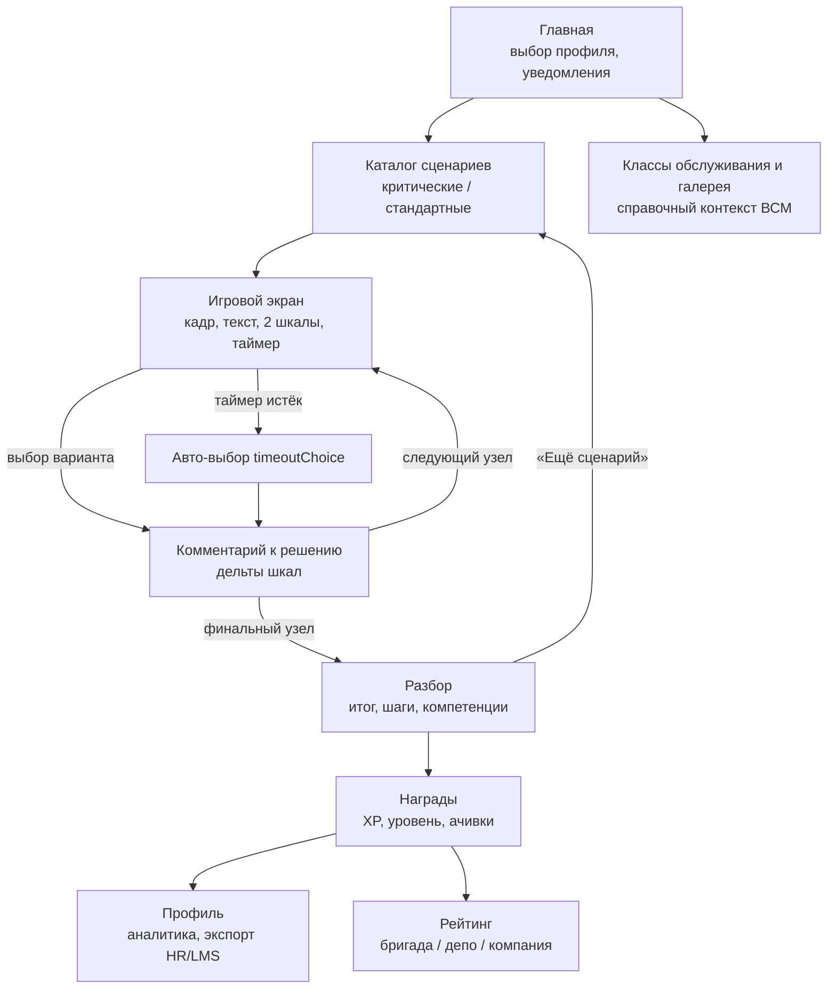
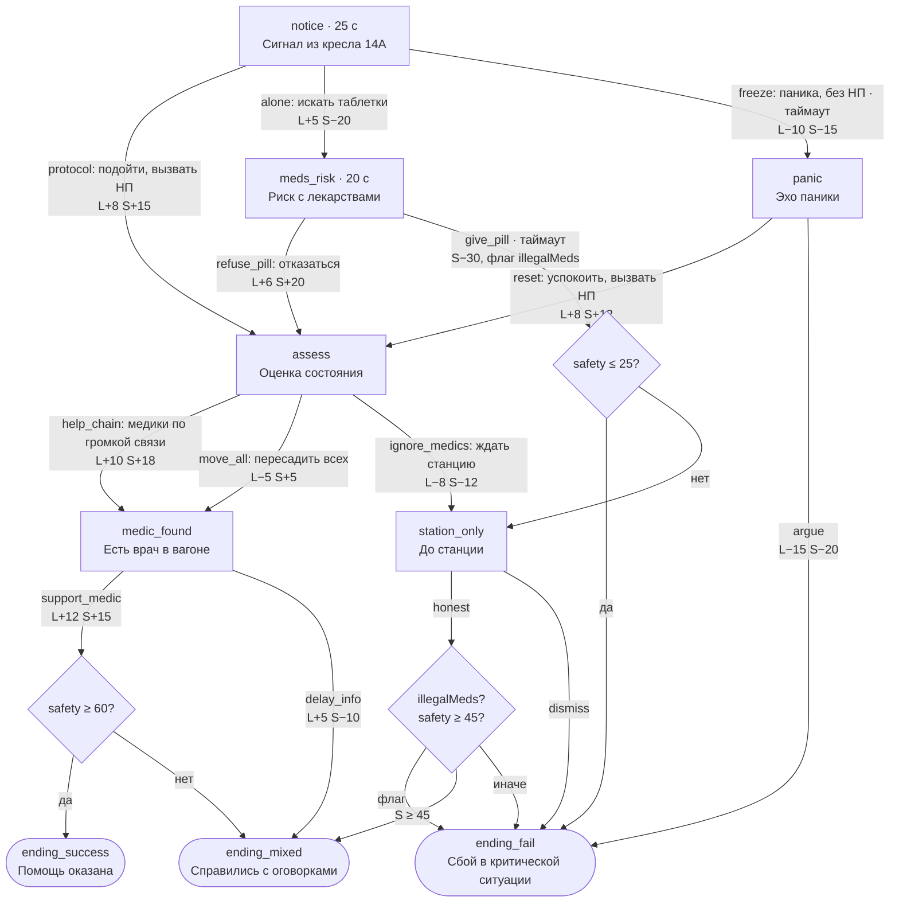
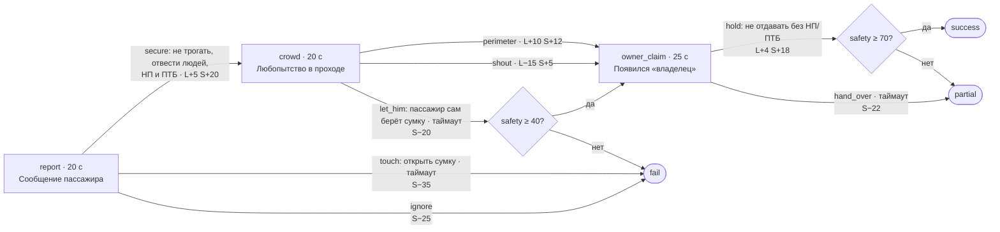

# Пользовательский сценарий (User Flow)

## Роли

| Роль | Что делает |
|------|------------|
| Проводник | Проходит сценарии, смотрит разбор, растёт в уровне и рейтинге |
| Методист / наставник | Добавляет развилки в «Редакторе» или новые сценарии в JSON, смотрит рейтинг бригады |
| HR / LMS | Забирает прогресс сотрудника через `GET /integrations/hr/export/{userId}` |

## Путь проводника по экранам



1. **Главная.** Проводник выбирает демо-профиль (по умолчанию Мария Козлова). Видит уровень, XP, ачивки и уведомления, например челлендж бригады.
2. **Каталог.** 9 сценариев с обложкой, сложностью, длительностью и компетенциями.
3. **Игровой экран.** Слева шкалы «Лояльность» и «Безопасность» (старт 50/50), XP сессии и таймер. Справа кадр ситуации, текст и 2–3 варианта. Какой вариант верный, не видно.
4. **После выбора.** Короткий комментарий тренажёра, шкалы меняются с показом дельты, затем следующий узел.
5. **Таймер истёк.** Засчитывается `timeoutChoice` узла — как правило, это пассивный или неверный вариант. Промедление тоже решение.
6. **Разбор.** Итоговые шкалы, вывод по исходу, каждый шаг с пояснением и лучшей альтернативой, сильные компетенции и пробелы.
7. **Награды.** XP, новый уровень, открытые ачивки. Данные сразу попадают в профиль и рейтинг.

## Каталог сценариев

| ID | Название | Тип | Таймер, с | Узлов | Вариантов | Компетенции |
|----|----------|-----|-----------|-------|-----------|-------------|
| `medical-emergency` | Пассажиру стало плохо | критический | 20–30 | 9 | 14 | безопасность, эмпатия, регламент |
| `unattended-bag` | Бесхозная вещь | критический | 20–25 | 6 | 8 | безопасность, регламент, конфликты |
| `smoking-onboard` | Курение на борту | критический | 18–20 | 5 | 5 | безопасность, регламент, конфликты |
| `lost-child` | Ребёнок потерялся | критический | 22–25 | 6 | 7 | эмпатия, безопасность, регламент |
| `pet-carrier` | Питомец без переноски | стандарт | 20–30 | 9 | 14 | сервис, регламент, эмпатия |
| `boarding-ticket` | Посадка без действительного билета | стандарт | 15–30 | 8 | 12 | регламент, эмпатия, сервис |
| `cabin-conflict` | Шум и спор в салоне | стандарт | 15–25 | 7 | 10 | конфликты, эмпатия, сервис |
| `pet-allergy` | Аллергия на животных | стандарт | 18–28 | 7 | 10 | эмпатия, сервис, безопасность |
| `luggage-aisle` | Ручная кладь в проходе | стандарт | 20–22 | 6 | 7 | безопасность, сервис, эмпатия |

Всего 63 узла, 87 вариантов решений, 27 финалов: у каждого сценария есть `success`, `partial` и `fail`.

## Пример 1. «Пассажиру стало плохо» (`medical-emergency`)

Бизнес-класс, маршрут Москва — Санкт-Петербург. До ближайшей станции ~12 минут.

### Граф ветвлений



### Три прохождения

Старт: лояльность 50, безопасность 50. Шкалы ограничены диапазоном 0..100.

| Шаг | Эталон | С оговорками | Провал |
|-----|--------|--------------|--------|
| 1 | `protocol` → 58 / 65 | `protocol` → 58 / 65 | `alone` → 55 / 30 |
| 2 | `help_chain` → 68 / 83 | `move_all` → 53 / 70 | `give_pill` (или таймаут) → 59 / 0, флаг `illegalMeds` |
| 3 | `support_medic` → **80 / 98** | `delay_info` → **58 / 60** | — |
| Исход | `success`, +70 XP | `partial`, +30 XP | `fail`, 0 XP |

Что показывает разбор:

- **Эталон.** «Вы — координатор помощи, а не „главный врач“». На первом прохождении, например, открываются ачивки «Первая смена», «Страж безопасности», «Баланс профессионала».
- **С оговорками.** Про пересадку всего салона: «Хаос в проходе мешает помощи. Достаточно освободить доступ к креслу». Про обещания пассажирам: «Нельзя давать непроверенные обещания о движении поезда». К каждому пояснению приложена лучшая альтернатива.
- **Провал.** «Личные лекарства выдавать нельзя: неизвестна реакция, ответственность ляжет на вас». Лучшая альтернатива — вызвать начальника поезда и действовать в рамках аптечки.

Ключевая механика: в узле `meds_risk` по таймауту засчитывается `give_pill`. Растерянность в критической ситуации приводит к худшему исходу, а флаг `illegalMeds` не даёт «отыграться» на следующем шаге.

## Пример 2. «Бесхозная вещь» (`unattended-bag`)



Эталон `secure → perimeter → hold` даёт `success`: 69 / 100, +70 XP. Этот путь проверяет `npm run smoke`. Если на первом шаге промедлить, засчитывается `touch` («открыть сумку») — это сразу провал: бесхозную вещь трогать нельзя.

## Пример 3. «Питомец без переноски» (`pet-carrier`)

Стандартный кейс на конфликт сервиса и правил.

- `calm_rule → offer_buy → help_place` — эталон: правило соблюдено, пассажир доволен.
- `wave_through` («раз маленькая — проходите») даёт лояльность +8, но безопасность −18. Дальше жалоба соседа на аллергию, и лучший возможный исход — `partial`.
- `bark` (жёсткий отказ) ведёт к эскалации. Выйти можно только через деэскалацию и подключение начальника поезда.

## Пример 4. «Шум и спор в салоне» (`cabin-conflict`)

Тихая личная просьба (`soft`), нейтралитет при ответной реакции (`separate` или `call_np`) и повторный подход к пассажиру (`followup`) дают `success`. Если встать на сторону одного из пассажиров (`take_side`) или снимать конфликт на телефон (`film`), ситуация ухудшается или проваливается.

## Методист: добавление развилки

Через интерфейс: **Редактор** (`/lab`) → выбрать сценарий и узел → текст варианта, следующий узел, дельты шкал, XP, пояснение → «Добавить развилку в JSON». Граф проверяется перед записью, и новый вариант доступен со следующего прохождения.

Вручную — в JSON сценария, массив `choices[]` у узла:

```json
{
  "id": "new_branch",
  "text": "Новый вариант",
  "effects": { "loyalty": 5, "safety": -5, "xp": 10 },
  "competencyTags": ["сервис"],
  "feedback": "Пояснение после выбора",
  "betterAlternative": "Что было бы лучше (для слабых вариантов)",
  "next": "existing_node_id"
}
```

Условный переход:

```json
"next": {
  "conditions": [
    { "if": { "safety": { "gte": 60 } }, "goto": "ending_success" },
    { "if": { "flags": { "illegalMeds": true } }, "goto": "ending_fail" },
    { "else": "ending_mixed" }
  ]
}
```

Новый сценарий — это новый файл в `backend/data/scenarios/`, подробнее в [deployment.md](deployment.md#добавление-сценария). Медиа кладутся в `frontend/public/scenes/`: поле `coverImage` у сценария и `image` у узла.
